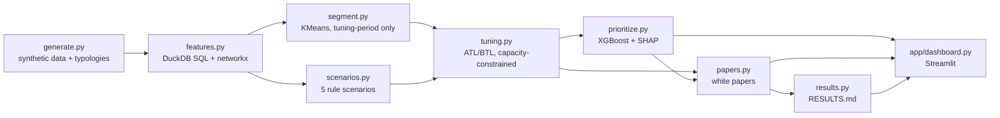
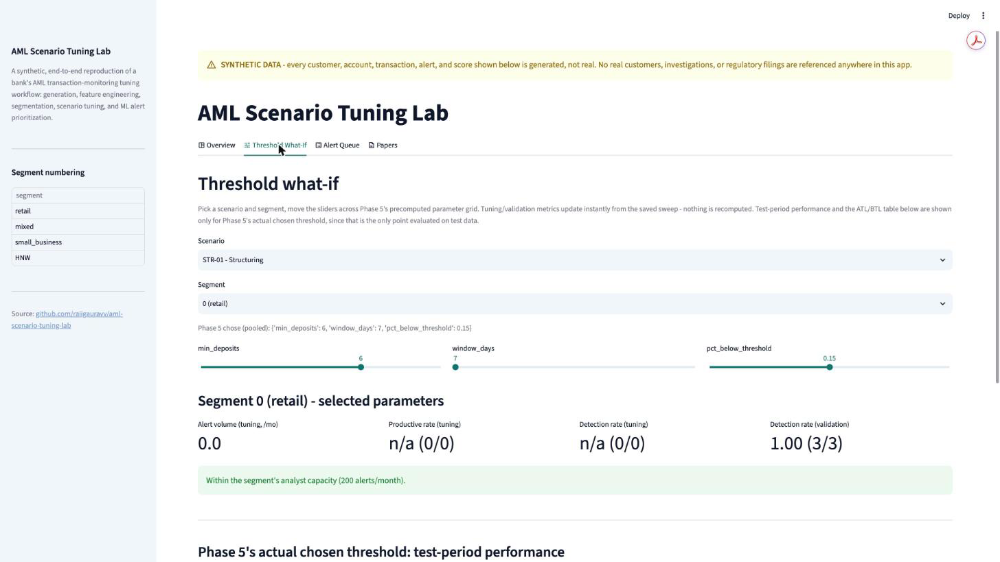
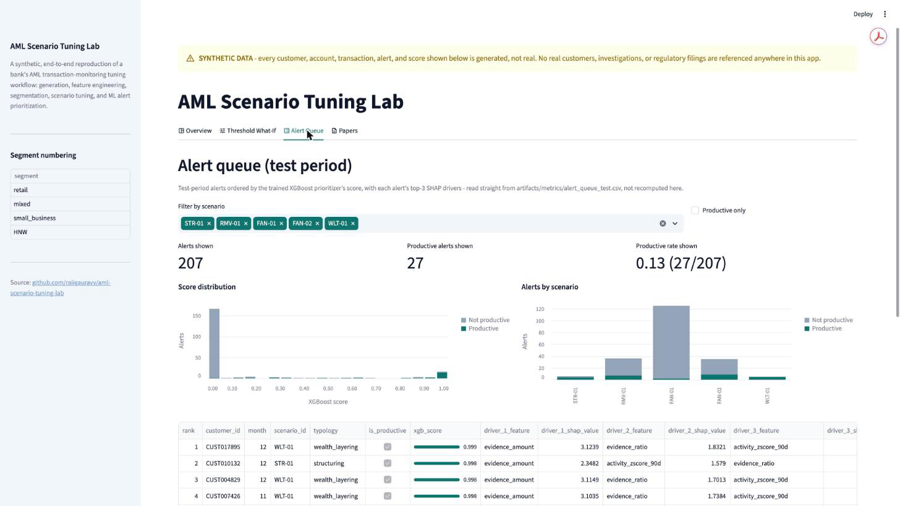

# AML Scenario Tuning Lab

> **SYNTHETIC DATA ONLY.** Every customer, account, transaction, alert, and score in this repository is generated by `src/aml_lab/generate.py`. No real customers, investigations, or regulatory filings are referenced anywhere - in the code, the data, the papers, or the dashboard.

This project reproduces the core workflow of a bank's AML transaction monitoring data science team, end to end, on fully synthetic data: rule-based detection scenarios with named, tunable parameters; customer segmentation before tuning; threshold calibration per segment under an explicit analyst-capacity constraint, with above-the-line/below-the-line (ATL/BTL) testing to show what each chosen threshold misses; a machine-learning layer that *reorders* rule alerts for review priority without ever suppressing a scenario hit; and model white papers generated entirely from the saved metrics, in the same shape a model validator would expect to review.

## Pipeline



## Headline results

Pulled directly from [RESULTS.md](RESULTS.md) (generated by `make results` - nothing below is hand-typed):

| Scenario | Validation detection | Validation productive rate | Test detection | Test productive rate | Test alerts/month |
|---|---|---|---|---|---|
| STR-01 | 1.00 (4/4) | 1.00 (4/4) | 0.50 (4/8) | 0.67 (4/6) | 3.0 |
| RMV-01 | 1.00 (6/6) | 0.13 (6/47) | 0.78 (7/9) | 0.19 (7/36) | 18.0 |
| FAN-01 | 0.12 (2/17) | 0.02 (2/114) | 0.18 (2/11) | 0.02 (2/119) | 62.5 |
| FAN-02 | 0.41 (7/17) | 0.64 (7/11) | 0.82 (9/11) | 0.26 (9/35) | 17.5 |
| WLT-01 | 1.00 (4/4) | 1.00 (4/4) | 1.00 (5/5) | 1.00 (5/5) | 2.5 |

**Alert prioritization (XGBoost vs. baselines, test period):**

| Model | PR-AUC (mean) | 95% CI |
|---|---|---|
| XGBoost | 0.8603 | [0.7421, 0.9449] |
| Logistic regression | 0.8447 | [0.7151, 0.9413] |
| Scenario prior (no learning) | 0.528 | [0.3544, 0.6868] |

See [RESULTS.md](RESULTS.md) for the full ATL/BTL table, the FAN-02 ring-level report, and the complete equal-detection (false-positives-avoided) breakdown.

## Dashboard




## Model white papers

Generated entirely from `artifacts/metrics/*.json` - see [`src/aml_lab/papers.py`](src/aml_lab/papers.py):

- [STR-01 - Structuring](artifacts/papers/STR-01.md)
- [RMV-01 - Rapid Movement](artifacts/papers/RMV-01.md)
- [FAN-01 - Fan-in/Fan-out, simple degree rule](artifacts/papers/FAN-01.md)
- [FAN-02 - Fan-in/Fan-out, ring detection](artifacts/papers/FAN-02.md)
- [WLT-01 - Investment/Wealth Layering](artifacts/papers/WLT-01.md)
- [Alert Prioritization (ML reordering)](artifacts/papers/prioritization.md)

## How to run

```bash
pip install -e ".[dev]"

make all            # generate -> features -> segment -> scenarios -> tuning -> model -> papers -> RESULTS.md
make test            # full pytest suite
streamlit run app/dashboard.py
```

Individual stages (`make data`, `make features`, `make segment`, `make scenarios`, `make tuning`, `make model`, `make papers`, `make results`) can be run on their own; each depends on the stage(s) before it. `make data-small` uses a smaller customer count for a fast local run.

## Repo layout

```
aml-scenario-tuning-lab/
  README.md
  RESULTS.md                  # generated by `make results`
  Makefile
  pyproject.toml
  config/
    generator.yaml            # synthetic data generation parameters
    scenarios.yaml            # scenario definitions + parameter grids
    capacity.yaml             # analyst review capacity assumptions
    segments.yaml             # segmentation settings
  src/aml_lab/
    generate.py                # synthetic data + injected typologies
    features.sql / features.py # DuckDB feature layer
    segment.py                 # KMeans customer segmentation
    scenarios.py                # rule engine (5 scenarios, evidence-bearing)
    tuning.py                   # threshold sweeps, ATL/BTL, capacity constraint
    prioritize.py                # XGBoost alert prioritization + SHAP
    papers.py / results.py       # white papers + RESULTS.md generation
  templates/                    # Jinja2 templates for papers and RESULTS.md
  app/dashboard.py               # Streamlit dashboard (3 tabs)
  artifacts/                    # generated: data, metrics JSON, figures, papers (committed - see below)
  docs/images/                  # dashboard screenshots
  tests/
  .github/workflows/ci.yml
```

Generated parquet data, trained model binaries, and other large/raw artifacts are gitignored and reproducible via `make all`. The small, human-readable results - metrics JSON, the alert queue CSV, white papers, figures, and the data card - are committed so they're visible on GitHub without running the pipeline.

## Limitations

- **All data is synthetic.** Nothing here reflects a real institution's customers, risk profile, or alert volumes.
- **Injected typologies make detection easier than reality.** Real laundering is messier, less separable, and adversarially adapts to known controls; this dataset's typologies do not.
- **No real regulatory context.** Thresholds, capacity assumptions, and "productive alert" definitions are illustrative, not calibrated to any actual jurisdiction's reporting regime.
- **No human-labeled investigation outcomes.** "Productive" here means "hits a known-injected typology," not an analyst's SAR/no-SAR decision - a real system's labels are noisier and slower to arrive.
- **FAN-02's ring-level numbers rest on 5 labeled ring instances.** Any "X of 5 rings" figure is a small, directional count, not a precise rate.
- **FAN-01/FAN-02 detect 0 cases in the tuning period itself**, despite detecting cases in validation and test - investigated and explained (not a bug): the two tuning-period ring instances are the dataset's structural worst cases (one straddles a month boundary, the other is undersized), and the capacity constraint rules out any threshold loose enough to catch them. See the FAN-02 paper and `tuning_FAN-02.json`'s limitations list for the full trace.
- **STR-01's chosen window size was decided by a tie-break**, not a clear winner: three window sizes performed identically on the (small) validation set, and the tie-break toward minimum alert volume happened to pick the one that generalizes worst to the test period's wider-spread cases.
- **Logistic regression ties XGBoost's alert capture at every review budget tested**, despite a lower PR-AUC - the practical ranking advantage of the more complex model is smaller than the PR-AUC gap alone suggests.
- **FAN-01 is a weak alert queue for the ML prioritizer too** - its PR-AUC (0.52) is barely above chance, carrying the largest single share of test-period alerts. Ranking doesn't fix a rule with little separable signal to rank.

## Planned

- A PySpark (Spark SQL, Hive-compatible) alternative to the DuckDB feature layer, kept optional so `make all` still works without it.
- An unsupervised anomaly-detection layer (e.g. Isolation Forest), compared against the rule scenarios and the supervised prioritizer.
- PDF export of the model white papers, alongside the Markdown already generated.
- Network analysis via connected components / Louvain communities feeding a ring-level scenario directly (FAN-02 already lays the groundwork).

## License

MIT - see [LICENSE](LICENSE).
